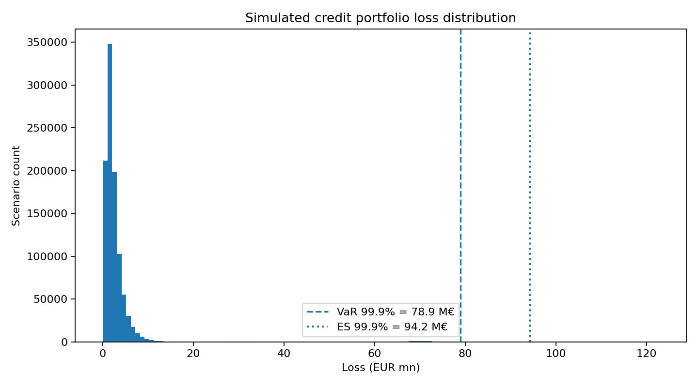
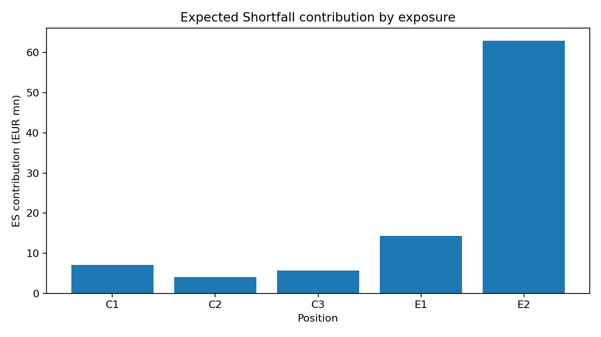
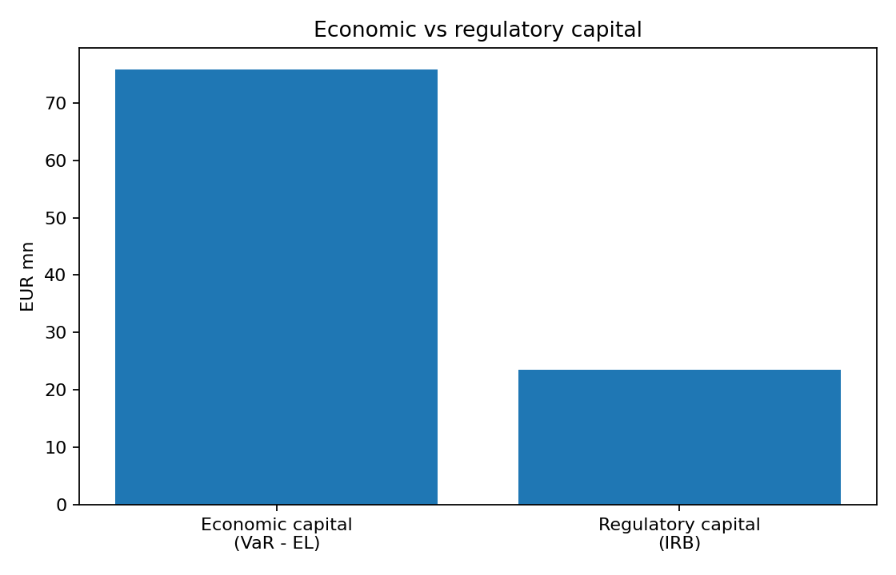

# Credit Portfolio Risk & Economic Capital

This project models the loss distribution of a mixed credit portfolio and compares an internal economic-capital view with Basel IRB-style regulatory capital.

It started from an exercise developed during my MSc in Quantitative Finance and I later reimplemented the model in Python to make the simulation reproducible and to explore the effect of concentration risk in more detail.

The portfolio contains three granular retail sub-portfolios and two single-name corporate exposures. Inputs are synthetic and monetary values are expressed in EUR millions.

## Project overview

The analysis combines:

- PD, LGD and EAD-based credit-loss modelling;
- correlated systematic risk factors generated with a Cholesky decomposition;
- conditional Vasicek/ASRF losses for granular retail portfolios;
- discrete defaults for large corporate exposures;
- Monte Carlo simulation of the portfolio loss distribution;
- Expected Loss, VaR and Expected Shortfall;
- economic capital based on unexpected loss;
- Basel IRB-style capital and RWA;
- tail-loss contributions by exposure.

The main point of the exercise is to study how portfolio structure affects tail risk. The retail books are treated as highly granular, while the two corporate names retain idiosyncratic default risk. This makes it possible to see how a small number of large exposures can dominate losses in extreme scenarios.

## Results

The default run uses **1,000,000 Monte Carlo scenarios** with seed 42.

| Metric | Result |
|---|---:|
| Expected Loss | 3.065 M€ |
| Analytical Expected Loss | 3.079 M€ |
| VaR 99.9% | 78.860 M€ |
| Expected Shortfall 99.9% | 94.173 M€ |
| Economic Capital (VaR - EL) | 75.795 M€ |
| IRB Regulatory Capital | 23.454 M€ |
| RWA | 293.171 M€ |

The simulated Expected Loss is close to the analytical value `Σ(PD × LGD × EAD)`, which provides a simple validation check for the Monte Carlo model.

The largest difference appears between economic and regulatory capital. In the simulated tail, the two corporate exposures account for most of Expected Shortfall, with E2 as the main contributor. The result illustrates the impact that single-name concentration can have when compared with a regulatory framework based on asymptotic granularity.







## Repository structure

```text
credit-risk-economic-capital/
├── README.md
├── run_analysis.py
├── requirements.txt
├── data/
│   ├── portfolio.csv
│   └── sector_correlation.csv
├── src/
│   ├── model.py
│   ├── metrics.py
│   ├── irb.py
│   └── plotting.py
├── notebooks/
│   └── credit_risk_model.ipynb
├── results/
│   ├── summary.json
│   ├── es_contributions.csv
│   ├── irb_capital.csv
│   └── *.png
├── docs/
│   └── methodology.md
└── tests/
    └── test_model.py
```

## Running the project

Create an environment and install the dependencies:

```bash
python -m venv .venv
source .venv/bin/activate        # Windows: .venv\Scripts\activate
pip install -r requirements.txt
```

Run the full analysis:

```bash
python run_analysis.py --scenarios 1000000 --seed 42
```

Run the tests:

```bash
pytest -q
```

The notebook in `notebooks/credit_risk_model.ipynb` follows the same analysis step by step with intermediate tables and plots.

## Methodology

A more detailed description of the model is available in [`docs/methodology.md`](docs/methodology.md).

At a high level, each Monte Carlo scenario is generated as follows:

1. Simulate three correlated sector factors.
2. Convert each retail factor into a conditional default rate using the Vasicek/ASRF formulation.
3. Simulate default events for the two corporate names, keeping their idiosyncratic components.
4. Aggregate losses across all five exposures.
5. Repeat the process to obtain the empirical loss distribution.
6. Calculate tail-risk metrics and compare them with IRB regulatory capital.

## Scope

This is an academic credit portfolio model rather than a production banking implementation. In particular:

- PD, LGD, EAD and correlations are fixed synthetic inputs;
- parameters are not calibrated from real borrower data;
- LGD is deterministic;
- the model does not include IFRS 9 staging or lifetime ECL;
- it does not build borrower-level scoring or rating models;
- the IRB formulas follow the specification used in the original coursework;
- concentration is represented through two explicit single-name corporate exposures.

Possible extensions would include parameter calibration, stochastic LGD, additional systematic factors, scenario analysis and a more detailed treatment of concentration risk.
